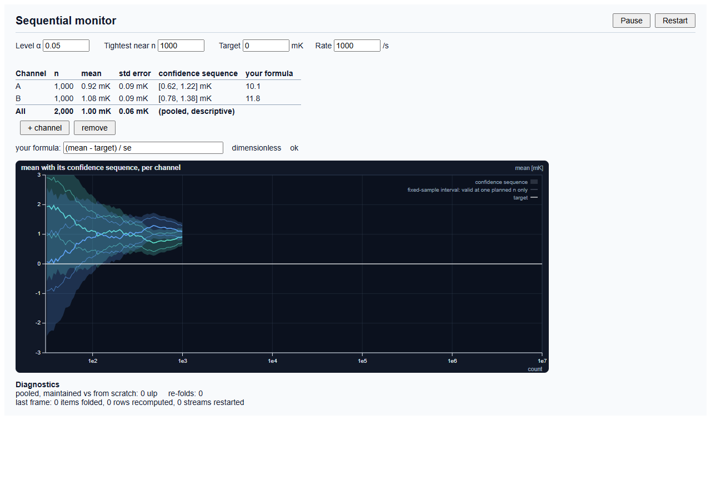
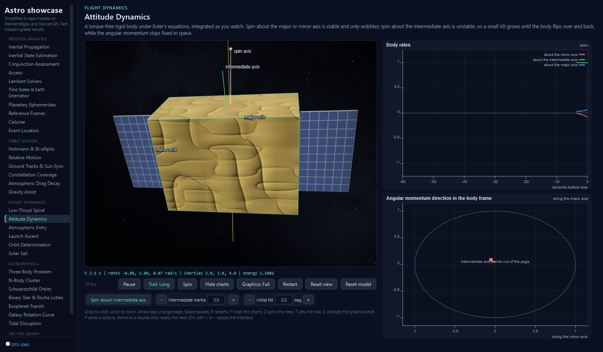
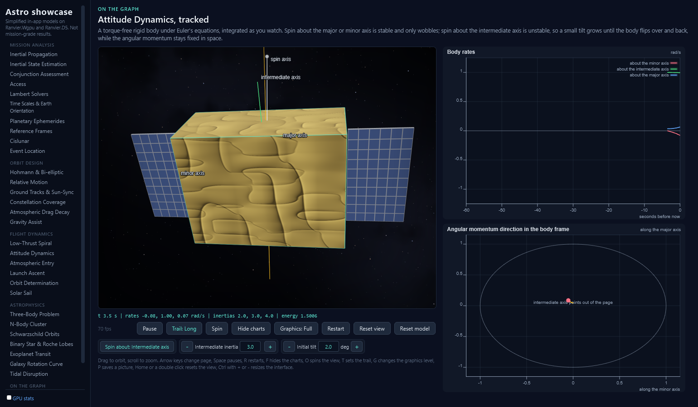

# Findings of the science vertical slice

The slice built, in this repository, a library of units, quantities, a float policy, statistics and a restartable
`Run`; a sequential monitor page for a native window and a browser (`examples/Monitor`); and two AstroShowcase pages
ported onto tracked quantities in a versioned copy of the app (`examples/AstroTracked`). It was built to answer five
questions, Q1 to Q5, of its design (`Ranvier/docs/superpowers/specs/2026-11-19-science-vertical-slice-design.md`, §1).
This report gives the answers and what follows from them, as the design's §10 asks. The design documents, and the plans cited below, are not yet published: they are committed only on a local branch of the core checkout.

How to read it:

- The report measures nothing. Every figure is copied from a file under `docs/` and carries that file's label and name.
  *Measured here* means measured in this repository by the run the named file records; *from documentation* names the
  file that was read; *general knowledge* was not checked.
- Two figures are compared only where the named file took both from one run; figures of repeated runs are listed
  together, each run's own. A figure of the native window is never compared with a figure of the browser.
- Code facts cite this repository at commit `c8a31f8` (the `tracked` mode's check after the second creation at
  `09928d7`), or the core's source in the `Ranvier` clone at `25a4452`, the 0.2.0 baseline of the design.
- Plan defects, rulings and open items come from the ledgers of the three plans, the controller's working records in
  `.superpowers/sdd/`, which are not under version control. Plan 2's ledger was deleted with its workspace and is read
  here from an extract rebuilt from the session transcript; the extract says it may miss Task 9's completion line and
  the final review's triage. Rulings keep the ledgers' names: P3-n for Plan 3, R-x and Dn for Plan 2.

## 1. Answers to Q1 to Q5

### Q1: what a node costs around a real formula body, and where the grain lies

Source: `docs/measurements/node-cost.md`, two BenchmarkDotNet runs, *measured here* on 2026-11-19. Every figure in this
answer comes from that file and is *measured here*, except the inference marked as one. One operation is one call of
the path. Ratios are taken within one run, against that run's `Direct` row of the same body.

- **Time a node adds to a write-then-read.** On the three cheaper bodies, run 1, the `NodeWritten` path (a signal
  written, then the memo read) adds 24.40 ns for `kepler` (34.06 - 9.66), 26.45 ns for `rate` (36.04 - 9.59) and
  27.77 ns for `rigidStep` (88.73 - 60.96), "that is 24 to 28 ns". As ratios to the direct call: 3.55 (`kepler`),
  3.76 (`rate`) and 1.458 (`rigidStep`).
- **`decay`.** Run 2, with three launches per row, gives `NodeWritten` 13,909.2013 ns against `Direct`
  14,024.3487 ns, a ratio of 0.992, and the two intervals overlap: the time the node adds is not resolved. Run 1's
  `decay` ratios are not used, because there the paths that do more work read below `Direct`. The file notes that the
  level of this body's rows differs from one benchmark process to another, with no cause shown by the runs.
- **Allocation.** The write-then-read path allocates what the direct call allocates, on every body: nothing for
  `kepler`, 24 B for `rate`, 720 B for `rigidStep` and 64344 B for `decay` (run 1). A read of a cached node
  (`NodeCached`) allocates nothing.
- **The range with no body.** Run 1's direct calls take 9.5865 ns (`rate`), 9.6593 ns (`kepler`), 60.9587 ns
  (`rigidStep`) and 18,518.2175 ns (`decay`). No body between `rigidStep` and `decay` was measured.
- **The grain.** Under the design's 10% rule, only `decay` has a write-then-read node under 10% more than its direct
  call: the ratio 0.992 of run 2, at about 14.0 us direct. `rate`, `kepler` and `rigidStep` do not qualify.
- **What that leaves unsaid about the 10% grain.** The cheapest body that qualifies lies somewhere between `rigidStep`
  and `decay`, and these runs cannot place it. The file's own inference, stated there as not a measurement: a node of
  24 to 28 ns against a body of 14 to 18 us "would be about 0.2% more". The node's cost in JavaScript was not
  benchmarked (the design, §6). The 10% is the design's proposal and the owner's to set (section 5).

### Q2: does a float policy fit as fold state, or must the core change?

It fits on core 0.2.0 with no core change, on both targets. It needed two devices the core does not offer directly.

- **As `Projection.foldGroupBy` state.** `Aggregate.sumBy` and `Aggregate.momentsBy` keep an accumulator with the row
  count and the removals since the last re-fold in a `Projection.foldGroupBy` (`src/Ranvier.Numerics/Aggregate.fs`).
  A re-fold is requested by raising: `subtract` raises `ArithmeticException` when the state is not finite or the
  removals reach the policy's limit, and the core's `ProjectionFold.Step` turns any exception from a step into one
  re-fold in the same read (*from documentation*: `docs/PROBES.md`, "Raising from `subtract`", which reads
  `Ranvier/src/Ranvier/Combinators.fs`, 1058-1064 and 1294-1295). The core's own `sumBy` uses the same device
  (`subtractFinite`, 1860-1865).
- **Re-folds under the standard policy.** An aggregate of N rows re-folds once per N removals, so a four-row aggregate
  whose rows all change between reads re-folds on every read. 400 edits, each followed by a read, gave 100 re-folds;
  100 batches of four edits, each followed by one read, gave 100 more (*measured here*: `docs/PROBES.md`, the same
  section, a `dotnet fsi` script against the Release build of `718f821`). The cost of the raise per read was not
  measured. The monitor page pools under `FloatPolicy.standard |> FloatPolicy.withRefoldFloor 64`, and its test bounds
  four channels over 600 frames at most 40 re-folds (*measured here*: `docs/PROBES.md`, on .NET and under Mocha).
- **As stream-fold state.** A stream fold notifies no reader of an item that leaves its state unchanged, on both
  targets, only when the fold returns the instance it received. An equal rebuilt struct notifies readers under
  JavaScript and none on .NET; an equal rebuilt record notifies them on both (*measured here*: `docs/PROBES.md`, probe
  E, E1 to E3). The library's folds return their input where an item leaves the state unchanged (`Sum.add`,
  `Moments.merge`, `Moments.unmerge`).
- **What the standard policy costs and gives** (*measured here*: `docs/measurements/aggregates.md`). Revising 1,000 of
  100,000 rows and reading the sum took 184.1 us under `standard` against 176.5 us under `fast` in run 1, a difference
  of 7.6 us, 4.3% of the `fast` mean, outside both rows' 99.9% error intervals. In the drift run, `fast` ended at most
  263 ulps from the exact sum and `standard` at 0.00; that is one input sequence, not a bound. The drift test printed a
  largest distance of 0 ulp before a re-fold under `standard` on both targets; its `fast` figures (196138 ulp over
  1000000 edits on .NET, 14 ulp over 100000 edits under JavaScript) come from runs of different lengths and are not
  comparable with each other.

### Q3: what a quantity must carry at run time

What an `Entry` carries (`src/Ranvier.Quantities/Model.fs`, 18-32): an identifier usable in formulas (`Id`), a name, a
run-time unit (`UnitInfo`: named factors with their exponents, `Factors`; a `Dimension` of seven exponents over the SI
base dimensions; and a `Scale`; the symbol is derived from the factors by `UnitInfo.symbol`;
`src/Ranvier.Quantities/Units.fs`, 19-26 and 113), a kind (input, constant or derived), the reference a constant was
taken from (`Source`, empty otherwise), a tracked read of the value as a number in its unit (`Read`), and a tracked read
of a status that never raises (`Status`: ready, pending or failed). A model resolves an identifier to its entry and a
child model falls back to its parent (`Model.TryFind`, 66-72), so in a row `mean` is that channel's mean and `alpha` is
the page's.

What the formula notation and the table needed beyond it (`examples/Monitor/model/Monitor.fs` and Plan 2's records):

1. **Unit equality within a tolerance.** Two routes to one unit can differ in the last place of the scale, so the
   checker accepts `UnitInfo.equivalent` (the same dimension, scales within a relative `1e-12`) where `sameUnit` is
   exact (`Units.fs`, 143-153; Plan 2's decision D3).
2. **Identifiers with a unit and no value.** A formula is parsed and checked once per edit, before any row exists,
   against `Schema`: a child model of constants, one per row identifier, that stand for the identifiers' units
   (`Monitor.fs`, `schemaOf`, 251-263). A model cannot declare an identifier with a unit and no node. Ruling R-AD made
   `Schema` a public field of the page so that a test could reach it.
3. **A stale state.** A formula that does not parse or check keeps the last valid formula's values and is marked stale
   beside its message (the design, §7.2). That state is a `FormulaState` (the text, the last valid formula, the error)
   in a memo beside the model (`Monitor.fs`, 67-73 and 284-304); `QuantityStatus` has no stale case.
4. **A result whose unit is known at run time.** A row's formula value is a `Memo<float>` (`Row.User`) with the checked
   formula's `UnitInfo` beside it, not a `Quantity`: `Quantity<'u>` fixes its unit at compile time. The result is not
   an entry, so no other formula can read it.
5. **A row state finer than the status.** The table's waiting, failed and not-finite cells come from the stream fold's
   `TryValue` and the count of its moments (`Monitor.fs`, `stateOf`, 153-165): a fold that holds its seed is ready to
   the graph and still waiting for data to the person reading the table.
6. **Number text of its own.** The cells are written by `Format.fixed'` and `Format.count`, built from IEEE double
   arithmetic alone so that .NET and JavaScript give the same characters (`examples/Monitor/model/Format.fs`, 6 and
   42-51); the precision is chosen per cell, and an entry carries none. An axis shows an entry whose unit has no symbol
   by its name alone (ruling R-U).
7. **Blocks are not entries.** A block's identifier is reserved in its model and is not an entry (`Model.fs`, 64-65),
   so the confidence sequence, a block, reaches formulas through two derived entries, `lower` and `upper`
   (`Monitor.fs`, 343-351).

Of the five things the design names (name, unit, dimension, source, status), an entry carries all five, `source` for a
constant only. What a derived quantity was computed from is not carried: the core lists a node's sources only in a
traced build (section 2, entry 7).

### Q4: how a per-frame pull of "the state at time t" meets the graph

- **`Run` is two memos** (`src/Ranvier.Quantities/Run.fs`, 71-89): one holds the state `start` produced, and one steps
  it from its previous value. The run is pulled: the clock is read only when something reads `State` (`Run.fs`, the
  doc comment of `createWith`), so a page that is not shown is not simulated. `advance` mutates the state in place, and
  each start or advance is published as a new `Stepped` wrapper, which the default equality sees as a change (*from
  documentation*: `docs/PROBES.md`, "`Run` publishing a new wrapper per start and advance"; a clock equal to the last
  value, within 1e-9 below it, or NaN publishes nothing).
- **The counts** (*measured here*: `docs/measurements/tracked-pages.md`, the `--tracked` run). Calls of `Decay.decay`
  across one change and the frame after it: the original page makes 112 for each of the three controls and for the
  reset; the tracked page makes 112 for the initial altitude, and 1 each for the ballistic coefficient, the solar
  activity and the reset. For the three controls these are the counts the design predicted (§8).
- **The comparison** (*measured here*: the same file and run). The script steps the clock through 1941 frames and reads
  the two Attitude Dynamics pages' states after 1911 of them; at every read the two states are bit-identical, with 7
  restarts of the run on each page, and in the script's steps 5 and 6 neither page restarts. The 30 frames of step 9,
  with the page away, are not read (ruling P3-2), and the count of `Attitude.advance` calls across them is 0 on each
  page: neither state moved. The two Decay pages give equal status text and equal lifetime bits at 7 settings and 2
  clock times each.
- **The rule that makes the port exact.** `start` reads each control through a memo created for the run alone, and the
  page shows a control's value from the input (`examples/AstroTracked/PagesTracked.fs`, 267-278). A control that
  `start` reads directly, or through a memo something else reads between two reads of the run, restarts the run when
  it is written away and back, where `Kit.Flow` compares a structural key and does not restart (*measured here*:
  `docs/PROBES.md`, "Differences from Kit.Flow", tests on .NET and JavaScript). That section lists three more
  differences: `Flow.Reset ()` has no counterpart, a failing `start` re-raises until a value it read changes, and a NaN
  clock at a start is not recorded; it says the list is not known to be complete.
- **Time, compared within one run each, not interpreted** (*measured here*: `docs/measurements/tracked-pages.md`).
  - *The control-change span*, from before a change of the ballistic coefficient to the end of the frame after it, the
    3D view's draw included; in each `--tracked` run the original Decay page is timed first, after the attitude script,
    and the tracked page second, each after one warm frame. Its median over 21 changes, original against tracked, was
    13.90 ms against 12.43 ms in the recorded run at `e41488d`, and 15.88 against 15.56 ms, 16.56 against 15.94 ms and
    8.39 against 12.31 ms in three later runs at `83a7baf`: within each run the tracked page's median minus the
    original's is -1.47, -0.32, -0.62 and +3.92 ms. The difference changes sign between runs, and the file draws no
    conclusion from it.
  - *The `--bench` frame*, the app's work after a 1/60 s write of the clock, with the 3D view drawn once, until the
    graph settles. Its means were 6.89 ms (Decay, original), 6.44 ms (Decay, tracked), 7.29 ms (Attitude, original)
    and 6.21 ms (Attitude, tracked), one run of 120 frames a page; the file reports those differences and does not
    interpret them.
  - Neither is the frame of Q5, which another benchmark times on the monitor page against its budget.

### Q5: does one page build and behave the same in the native window and the browser?

On text and numbers, yes, at the page's displayed precision and on the recorded stream. Visually, the pictures are for
the owner to compare by eye (section 8); no pixel equality is claimed.

- **One set of sources builds on both heads**, with no fallback (*measured here*: `docs/PROBES.md`, section B).
- **The table text.** The `table` script printed the same lines on the two targets, and each target's pinned text and
  DOM text agreed (*measured here*: `docs/measurements/monitor.md`, "The pinned scripts at `b440fa9`"):

  ```
  table | A | 1,000 | 0.92 mK | 0.09 mK | [0.62, 1.22] mK | 10.1
  table | B | 1,000 | 1.08 mK | 0.09 mK | [0.78, 1.38] mK | 11.8
  table | All | 2,000 | 1.00 mK | 0.06 mK | (pooled, descriptive) | 
  table | pinned text: equal | DOM text: equal
  ```

  The `counts` script's lines, which count scene builds, mark keys and node updates over a change of α, an added
  channel and one publication, were also the same on both targets and ended `counts | all as expected` (the same
  section).
- **The numbers beneath.** Folding the recorded stream of 1,000 doubles gives count, mean and variance exactly equal on
  .NET and JavaScript, and confidence-sequence bounds that agree to a relative difference of 0 (*measured here*:
  `docs/PROBES.md`, "One recorded stream on both targets"). The coverage test printed the same fractions on both
  targets (`docs/PROBES.md`, "Coverage").
- **The frame work, per target, against the budget.** The budget is 6.06 ms, the period of a 165 Hz display (*from
  documentation*: `docs/measurements/monitor.md`, "The budget"). One frame is the fold, recomputation, scene build and
  DOM writes of one frame plus one forced layout; paint and presentation are not timed, the window is hidden and Chrome
  headless, and no frame rate follows from these figures. This frame is the monitor page's, from the `frames` script,
  and is a different benchmark from the AstroTracked `--bench` frame of Q4; the two are not compared. Four runs of the
  `frames` script on each target (*measured here*: `docs/measurements/monitor.md`, "Results"):

  | Native, run | Commit | Default page, mean | Default page, 95th percentile | Highest rate under the budget |
  |---|---|---|---|---|
  | 1 | `3d0b878` | 0.47 ms | 2.08 ms | 512,000 /s per channel |
  | 2 | `3d0b878` | 0.47 ms | 1.96 ms | 512,000 /s per channel |
  | 3 | `b440fa9` | 0.43 ms | 2.05 ms | 512,000 /s per channel |
  | 4 | `8d1cb0e` | 0.44 ms | 2.07 ms | 256,000 /s per channel |

  | Browser, run | Commit | Default page, mean | Default page, 95th percentile | Highest rate under the budget |
  |---|---|---|---|---|
  | 1 | `3d0b878` | 0.72 ms | 5.70 ms | none (at 2,000 /s the 95th percentile is 6.80 ms) |
  | 2 | `3d0b878` | 0.62 ms | 4.90 ms | 8,000 /s per channel |
  | 3 | `b440fa9` | 0.59 ms | 4.90 ms | 8,000 /s per channel |
  | 4 | `8d1cb0e` | 0.62 ms | 5.00 ms | 2,000 /s per channel |

  At the default setting, four channels at 1,000 observations a second each, both figures are under 6.06 ms in four of
  four runs on each target. The browser's timer steps by 0.1 ms in runs 1 to 3 (*measured here*: the
  `frames | timer |` line), so each browser frame time can be off by up to 0.1 ms (*general knowledge* in that file,
  from the step). The highest rate under the budget moved between runs at commits that time the same work: "The value
  of one run is not a capacity figure".
- **Package versions each head ended on** (*measured here*: `docs/PROBES.md`, section B, from each head's
  `obj/project.assets.json`; repeated in `docs/measurements/monitor.md`, "Machine and versions"):
  - native: `Ranvier` 0.2.0, `Ranvier.View` and `Ranvier.View.Dom` 0.2.0, `Ranvier.View.WebCore` 0.2.0,
    `Ranvier.View.WebCore.Sdl` 0.2.1, `Ranvier.D5`, `Ranvier.D5.Charts` and `Ranvier.D5.View` 0.1.1, and in Debug
    `Ranvier.View.WebCore.Hmr` 0.1.3; beneath them `Ranvier.WebCore` 0.1.3 with `Ranvier.WebCore.Native.win-x64` 0.1.3
    (`docs/measurements/monitor.md`);
  - browser: `Ranvier` 0.2.0, `Ranvier.Dom` 0.1.0, `Ranvier.View` and `Ranvier.View.Dom` 0.2.0, `Fable.Core` 5.3.0, and
    `Ranvier.Css`, `Ranvier.Css.Core` and `Ranvier.Css.Bindings` 0.1.1. `Ranvier.D5`, `Ranvier.D5.Charts` and
    `Ranvier.D5.View` 0.1.1 are compiled from the `Ranvier.D5` clone at `08e5642`, whose working tree has an
    uncommitted change to its project file that adds two packaging items. Fickl 0.10.1 (Fable 5.27.0) built it
    (`docs/measurements/monitor.md`).

## 2. Core proposals

Each entry is a place where the slice worked around core 0.2.0. Each states what the core would offer, what that would
replace in the slice, and what it would owe the core's Rocq proofs (`Ranvier/proofs`) and counter benchmarks
(`Ranvier/bench/Ranvier.Counters`, run by `Ranvier/counters.ps1` on .NET and Node.js). The proof notes come from reading
`Ranvier/proofs/README.md`, `CORRESPONDENCE.md` and the theory files named; nothing was proved or run for this report.
Two facts apply to every entry: the model's values are integers (`val := Z`, `CORRESPONDENCE.md`, the reference tier),
so no theorem speaks of floating-point arithmetic; and no counter scenario builds a `foldGroup`, `foldGroupBy`, `sumBy`
or `Projection.fold` (read in `bench/Ranvier.Counters/Scenarios.fs` and `Workloads.fs`, and in the Fable harness
`fable/Ranvier.Counters/Scenarios.fs`).

1. **A float policy per aggregate.**
   - Offers: an aggregate built with a stated policy, compensated running sums and a re-fold rule (after as many
     removals as rows or a floor, and whenever the state is not finite), beside today's plain `Projection.sumBy`.
   - Replaces: `FloatPolicy`, `Aggregate.sumBy` and `Aggregate.momentsBy` in `src/Ranvier.Numerics`, and with them the
     raise of entry 2. Its measurement is Q2's: 184.1 us under `standard` against 176.5 us under `fast`, and a drift of
     at most 263 ulps under `fast` against 0.00 under `standard` (*measured here*: `docs/measurements/aggregates.md`).
   - Proofs: the policy's guarantees stay tests (the design's §7.4), since the model has no floats. The fold it sits on
     is stated in `theories/Pure/Deltas.v` (`fold_delta_sync_refines_diff`, `fold_pure_reorder_invariants`, over
     `Combinators.fs` 1004-1085), `theories/Heap/Deltas.v` and `theories/Pure/Collections.v`
     (`fold_sync_recomputes_on_reorder`), with the fold function abstract. A policy carried in `add`, `subtract` and
     the state leaves those statements unchanged; one that changes when `Sync` re-folds changes them. Which of the two a
     core design would be cannot be told before it is written.
   - Counters: a new scenario is owed; the slice's `Aggregates` and `KeyScaling` benchmarks
     (`bench/Ranvier.Science.Benchmarks`) are its candidates.
2. **A direct re-fold request in `foldGroupBy`, in place of an exception.**
   - Offers: a `subtract` that can answer "re-fold", for example by returning `ValueNone`, or a callback.
   - Replaces: the raise in `Aggregate`'s `subtract` and in the core's `subtractFinite`, the exception per re-fold on
     .NET, and the reliance on `Step` treating every exception alike (*from documentation*: `docs/PROBES.md`, "Raising
     from `subtract`").
   - Proofs: `theories/Pure/Deltas.v` (`fold_sync_membership`) and `theories/Pure/Collections.v` (`fold_sync_step`)
     take `Sync`'s `full` flag as an input, and neither states `Step`'s exception path. A step result that sets `full`
     gives that flag a second source and keeps the form of those statements; a request handled in a phase of its own
     would need a statement of its own. Read, not proved.
   - Counters: the nearest scenario, `fail-recompute`, times a failing memo body, not a fold; a fold scenario with
     re-folds is owed.
3. **A memo that keeps its stored value when a recomputed one compares equal (`Tolerance.hold`).**
   - Offers: a memo cutoff that keeps the published value when the comparer finds the new one equal, or a tolerance
     option on a memo (*from documentation*: `docs/PROBES.md`, "`Tolerance.hold` inside the memo's computation").
   - Replaces: `Tolerance.hold` in `Quantity.deriveWithin` (`src/Ranvier.Quantities/Quantity.fs`, 78-87),
     `Tolerance.holdSeries` through `Quantity.blockFrom`, and the page's `holdBand` (`Monitor.fs`, 192-224).
   - Proofs: the reference tier's memo has no comparer and no previous value; its cutoff compares outcomes by equality
     (`CORRESPONDENCE.md`, the `program_memos` row). The engine's comparer is one of `CmpEq`, `CmpNever` and `CmpThrows`
     (`theories/Base/Syntax.v`, line 24), applied in `run_memo` (`theories/Pure/Engine.v`). A tolerance is not
     transitive (the design, §7.4), so it is none of the three, and a memo that keeps an older value no longer holds its
     body's value over the current signals, which is what `den` gives (`theories/Pure/WholeGraph.v`). It would be a new
     comparer form through `Syntax.v`, `Engine.v`, `Heap/Run.v` and the differential check's generator, and outside the
     `CmpEq` fragment of `Pure/Refinement.v` unless that fragment is widened. The slice's stand-in, returning the
     previous value from `compute`, is in the engine's command language (`EPrev`, the `prev_var` row) and is excluded
     from `Pure/WholeGraph.v`'s statement over all programs by its premise `memos_no_prev`.
   - Counters: `cutoff` ("write an equal value to an observed source"), `derive-effect` and `derive-on` ("write a new
     value whose derived value is unchanged") time the paths a change of cutoff would alter.
4. **A comparer for a stream fold's state and for `foldGroupBy`.**
   - Offers: overloads of `createStreamFold` (`Api.fs`, 439) and `Projection.foldGroupBy` (`Combinators.fs`, 1843) that
     take an `IEqualityComparer`, as `createMemoWithComparer` (`Api.fs`, 274) does for a memo. Neither takes one at
     `25a4452`.
   - Replaces: the rule that a fold returns the instance it received (`Sum.add`, `Moments.merge`, `Moments.unmerge`),
     `momentsBy`'s projection returning its previous instance for an unchanged row, and with them the difference between
     targets of probe E2 (*measured here*: `docs/PROBES.md`, section E and "A fold returning its input").
   - Proofs: a stream memo is outside the model's node kinds (`CORRESPONDENCE.md`, the `kind` row: `Signal`, `Memo`
     and `Effect`), so a comparer on its state touches no theorem and gains none. `Pure/Deltas.v` states `Sync` with
     row values abstract; whether a row comparer changes what it states cannot be told without the design.
   - Counters: `stream-burst-1`, `stream-burst-16`, `stream-burst-256` and `stream-restart` for stream folds;
     `project-edit` for a row edit.
5. **A memo whose computation reports whether it moved (`Run`'s wrapper per step).**
   - Offers: a computation that returns, beside its value, whether it moved, so that a state mutated in place is
     published without a new object per step (*from documentation*: `docs/PROBES.md`, "`Run` publishing a new wrapper
     per start and advance").
   - Replaces: `Stepped`, the wrapper `Run` allocates per start and per advance (`Run.fs`, 10-16 and 73-89).
   - Proofs: whether a memo moved is decided in `run_memo` by its comparer form (`Syntax.v`, `Engine.v`); a body that
     reports it would be a fourth form, unmoved when it says so and `CmpNever` otherwise, through the same files as
     entry 3. The model's values are immutable integers, and `memo_value_extensional` (`theories/Reference/Properties.v`)
     has a memo's value depend only on the signals its evaluation discovers; a state mutated in place by an untracked
     `advance` is outside that statement. Which other theorems take the comparer form as a premise was not read.
   - Counters: `chain` and `cutoff`. No scenario steps a run.
6. **An owner-scoped registry (a `Model` holds entries after their nodes' owner is disposed).**
   - Offers: a registry whose entries leave when their owner is disposed, or a lookup from an owner.
   - Replaces: `Model`'s plain collections with no removal (`Model.fs`, 37-39 and 84-87), and the new model per mount
     in the tracked pages (`PagesTracked.fs`, 112 and 263). With today's core a
     declaration could register an `onCleanup` that removes its entry, which needs a removal on `Model`
     (*from documentation*: `docs/PROBES.md`, "A model holding entries after the owner of their nodes is disposed").
     The view needs the same lookup: its accepted exception of 2026-10-25 keeps a `WeakMap` "because the core has no
     owner-scoped lookup" (`Ranvier/.claude/rules/view-uses-core.md`).
   - Proofs: owners, cleanups and teardown order are stated in `theories/Pure/Ownership.v` and
     `theories/Heap/Ownership.v` (`heap_ownership_guarantees`). A registry kept by cleanups uses what they state; one
     held in `Owner` adds a field to `owner_state` (`CORRESPONDENCE.md`) and to the heap representation.
   - Counters: `create`, `dispose`, `create-on` and `dispose-on`, which create and dispose a root of rows.
7. **Enumeration of a node's sources in release builds.**
   - Offers: a read of the nodes a computation read in its last run, compiled into every build. Today the tracer that
     reports edges is compiled under `RANVIER_TRACE` only (`Ranvier/src/Ranvier/Trace.fs`, line 5), and a computation's
     `SourceCount` is internal (`Core.fs`, line 5363).
   - Replaces: nothing in the slice, which records no lineage of an F#-defined quantity (the design, §2, non-goals). It
     would let an entry name what a derived quantity was computed from, the part of Q3's "source" a derived entry
     lacks.
   - Proofs: the source list is stated in `theories/Pure/SourceList.v` and `theories/Heap/SourceList.v`, and
     `edge_iff_read` (`theories/Pure/Edges.v`) relates its slots to a computation's reads under `world_well_formed`
     (`CORRESPONDENCE.md`, the `edge` row). A read-only enumeration would be specified as the slots before the cursor
     (`read_prefix`) at a quiescent state, which those files describe; it adds no transition. What it answers while a
     computation runs would need a statement of its own.
   - Counters: a read-only member adds no work to an existing scenario. If it needs a field per computation, `chain`
     and `shape-dynamic` would show it; whether it does cannot be told before it is written.
8. **Observations with no proposal yet.**
   - A signal written away and back between two reads invalidates its direct readers: a run whose `start` reads `x0`
     directly restarts after the unread writes `x0: 4 → 7 → 4` (*measured here*: `docs/PROBES.md`, "Differences from
     Kit.Flow").
   - The doc comment at `Ranvier/src/Ranvier/Types.fs:292` reads "`===` at primitives, strings and reference types;
     value comparison at every other value type", while the code under it gives `float` and `float32` IEEE comparers
     and every other value type and `string` `EqualityComparer<'T>.Default`, so a string compares by value
     (`Types.fs`, 294-307).
   - Under the Expecto shim, `Expect.throwsT` for a `System` exception type accepts any exception, so the exception
     types the plans named are pinned on .NET only (*from documentation*: `docs/PROBES.md`, "Limits of the JavaScript
     suite", which reads `tests/Ranvier.Science.Tests.Fable/Expecto.fs`, 138-147).

## 3. Interfaces to change before widening

1. **The unit-equality rule.** `sameUnit` compares scales exactly and `equivalent` within a relative `1e-12`
   (`src/Ranvier.Quantities/Units.fs`, 148 and 152-153); the formula checker uses the second (D3). Two rules answer one
   question. `equivalent` scales its tolerance by the second argument only, so the two argument orders can differ at the
   boundary, and no test sits at the boundary (Plan 2, Task 2's deferred minors).
2. **The burn-in of the confidence sequence.** `ConfidenceSequence.ofMomentsAfter` takes the burn-in from each caller;
   the page passes `Monitor.BurnIn`, 30, and filters the band's samples by it separately (`Monitor.fs`, 121, 178 and
   348). Over the coverage test's 2,000 streams, read from t = 1 the sequence's miss fraction is 1.0, and from t ≥ 30
   it is 0.0415 (*measured here*: `docs/PROBES.md`, "Coverage"); coverage is known at two settings only (section 7).
   Before widening, the burn-in belongs with the sequence, with its coverage stated per setting.
3. **The re-fold floor.** `FloatPolicy.withRefoldFloor` is 0 under `standard` and `fast`, and the page sets 64
   (`docs/PROBES.md`, "Raising from `subtract`"). A caller that sets no floor gets a re-fold on every read from a small
   aggregate whose rows all change (Q2). The drift test bounds the distance between re-folds at floor 0 (at most 2 ulp,
   *measured here*: `docs/measurements/aggregates.md`); at the page's floor its test bounds the re-fold count, not a
   distance in ulps. Before widening, decide whether `standard` carries a floor of its own and what bound holds between
   re-folds under it.
4. **A quantity's unit is fixed at compile time and a formula's unit is known at run time.** `Quantity<'u>` carries an
   F# unit of measure; a formula's result is a `Memo<float>` with a `UnitInfo` beside it (Q3, item 4). A formula result
   is therefore no entry: no other formula, table or catalogue can read it as a quantity. A quantity typed by its
   run-time unit, with the F# measure as an optional view, would serve both.
5. **A model's entries outlive their nodes.** A model keeps every entry with no removal, and a second declaration of an
   identifier raises (`Model.fs`, 74-87). A disposed memo answers reads with its last value, and a failed one keeps its
   failure; the F# code gives the type's default for a memo that never ran (*from documentation*:
   `Ranvier/proofs/CORRESPONDENCE.md`, the row `apply_dispose` on a memo). So an entry whose owner is gone reads its
   last value, or keeps its failure. The tracked pages build a new model per mount to avoid the raise (Plan 3's
   second-creation check). A page that mounts and unmounts, or a reload under the `dev` host, meets one or the other: a
   raise on re-declaration, or stale entries in a model kept from before (section 2, entry 6).
6. **The tracked pages repeat drawing code because the originals' helpers take a control row.** The original pages'
   drawing helpers take the page's `float[]` row and the plan forbade changing an original expression, so the drawing
   was written again against the nodes: `PagesTracked.fs` 59-108 and 163-176 (Decay), 234-259 and 296-347 (Attitude)
   (rulings P3-4, P3-9, P3-12). Every further port would repeat its page's drawing in the same way. Helpers that take
   values, not a row, would serve the original and the tracked page alike. The `Page` record keeps its row arguments,
   which the tracked pages ignore (the design, §8).
7. **What Plan 2 and Tasks 3 and 4 recorded.**
   - The page's record needed fields the plan did not give it: `Internals`, for the functions that act on the channels
     (R-N), and `Schema` (R-AD); the native session needed the graph (`Session.Graph`, R-S).
   - The view's list construct takes an array, so the page reads the core's projection into an array, sorts it, and the
     view builds a second projection over the same keys (*from documentation*: `docs/PROBES.md`, "The core's
     projection read into an array for the view's `each`"). An `each` over a core projection would remove both.
   - `Ranvier.D5.View` attaches seven listeners to every mark, so the chart keeps its mark keys fixed per channel
     (*from documentation*: `docs/PROBES.md`, "A mark that comes or goes costs a page update").
   - `Run` has no counterpart of `Flow.Reset ()`, which the three-body page calls when it is left; its port needs a run
     created in the page's own owner (*from documentation*: `docs/PROBES.md`, "`Flow.Reset ()`").
   - A unit's scale is not checked for overflow through large or nested powers (`UnitInfo.power`; ruling R-L, left to
     the final review).
   - The tracked Attitude page's chart frame is one module-level value that reads no node, since nothing in it depends
     on a control (Task 4).

## 4. The cost of adding a key

Source: `docs/measurements/aggregates.md`, runs 1 to 4, *measured here* on 2026-11-19, and the core's source. Every
figure below comes from that file and is *measured here*; the code lines are *from documentation*, read in the source as
that file reads them.

- **The collection's key array.** A keyed collection builds an array of all its keys once per read that follows one or
  more key changes: `toArray` (`Ranvier/src/Ranvier/Collections.fs`, 28-41), called from `ReadDelta` (55-63) when
  changes are recorded since the last read. One operation of the benchmark (add one key, read, remove it, read) has two
  such reads. At 100,000 rows, a control that reads the key count and folds nothing allocated 782.98 of the
  785.54 KB per operation (99.7%) in run 4, "two key arrays of 100,000 `int`s (2 x 400,000 B = 781.25 KB) plus about
  1.7 KB"; at 10,000 rows 79.84 of 82.41 KB (96.9%). The control's allocation grew 9.8 times for 10 times the rows.
  Its time grew 27.7 times, which mixes the row count with a change of GC regime (Gen2 collections at 100,000 rows only)
  and is not a scaling law.
- **What the aggregate adds over the control** (run 4). At 10,000 rows, +1.72 us (6.1%) for the core's `sumBy` and
  +1.66 us (5.9%) for `Aggregate.sumBy` under `standard`, intervals disjoint; at both sizes about +2.6 KB of allocation
  (+2.57 KB and +2.56 KB). At 100,000 rows the time increment is undecided: +58.42 us for the core's and -58.91 us for
  `standard`, each outside the control's interval, and a path that does the control's work and a fold cannot be faster
  than the control. Runs 1 and 3 also put `standard` below the core's `sumBy`; "the order of the two is undecided".
- **The guide and the source.** The guide says "an O(N) key diff" (`Ranvier/docs/content/guide/aggregates.fsx`, line
  71) and the source "O(Δ) up to max(64, N) changes" (`Combinators.fs`, line 1775). Both predict the O(N) total seen
  here, because the collection builds its key array either way. The runs show that the aggregate's own allocation does
  not grow from 10,000 to 100,000 rows; they cannot show whether its time grows, since 10 times 1.7 us lies within the
  spread at 100,000 rows. So the difference between the guide and the source on the fold's own cost is not settled by
  these runs, and nothing was measured for bursts of more than one key.

## 5. Decisions for the owner

1. **Whether a compensated sum reads ±∞ for an infinite total.** Today an infinite row reads NaN under `standard` and
   the infinity under `fast` until it is removed, and the tests pin that
   (`tests/Ranvier.Science.Tests/AggregateTests.fs`, 243-300); the page shows such a channel as not finite and reads
   none of its statistics (D1).
2. **The 10% grain figure.** The design proposed 10% (§6). Only `decay` qualifies, and no body between `rigidStep` and
   `decay` was measured (Q1; *measured here*: `docs/measurements/node-cost.md`, "Grain"). The owner sets the figure;
   placing the threshold needs bodies in that range.
3. **Whether the ports move into `AstroShowcase`.** The ports live in a third copy of the sources because
   `AstroShowcase` has no version control (the design, §4). The copy takes no fixes from the others, and `COPY.sha256`
   records each copied file's hash, which shows any drift (`examples/AstroTracked/COPY.md`).
4. **Whether `Ranvier.Science` becomes an organisation repository**, and its name (the design, §5). At release it is the
   repository `ranvier-org/Ranvier.Science` on GitHub, created private on 2026-11-20 for the 0.1.0 release; making it
   public is the owner's decision, because `examples/AstroTracked` is a full copy of the unpublished AstroShowcase app.
5. **R-T: the table's header reads "confidence sequence"** where the design's sketch has "95% sequence" (*from
   documentation*: the design, §7.1): the level follows α, and α is split across channels, so a fixed percentage would
   be wrong or misread.
6. **R-AB: the fixed-sample line uses the per-channel α**, α divided by the channel count, so that it contrasts with
   the sequence at one level. At the page's setting that α is 0.05 / 4 (*measured here*: `docs/PROBES.md`, "Coverage",
   the test at the page's setting), with four channels A to D (*from documentation*: `docs/measurements/monitor.md`,
   "The script"), so the line's level is 1 − 0.05 / 4.
7. **R-AA: the row's band reads the fold's state, not the history alone**, so it recomputes on every publication of the
   fold, including one that adds no history sample, and returns its previous value when every array is held to the
   previous one. The cost of these recomputations was not measured (*from documentation*: `docs/PROBES.md`, "The row's
   band reads the fold's state, not the history alone").
8. **R-Z: the `frames` sweep is not repeated within one run.** The highest rate under the budget is a single pass per
   run, and it moved between runs (Q5). Repeat the sweep within a run before a capacity figure is quoted.

## 6. Plan defects found while building

From Plan 1:

- Task 6: two drift tests sampled only at edits where the standard policy had just re-folded, so they could not see
  drift between re-folds; their sample points were moved off the re-folds.
- Task 10: `Quantity` was declared sealed and then inherited by `Input`; `Quantity` became unsealed with an internal
  constructor.
- Review Focus 1's "the state shows NaN" does not hold for ±∞ under the fast policy.
- Task 13's "raises unless n > 0" sits beside NaN bounds for an empty sample, which raise nothing.

From Plan 2 (the ledger extract):

- R-A: the browser head compiles the `Ranvier.D5` clone, which the plan's constraints said is never built; the clone's
  `git status` was recorded before and after instead.
- R-C: Task 2 cited a unit pair in `docs/PROBES.md` that is in `tests/Ranvier.Science.Tests/UnitsTests.fs`.
- R-D: Task 2's "the bound the existing test of guarantee 4 in this file uses" named no test.
- R-E: `Format.tryNumber` was to read "as the formula notation reads a number", and the notation exposed no number
  reader.
- R-G: Task 5's test 7 asked for pooled moments bit-equal to the from-scratch ones after a removal that, under the
  page's re-fold floor, makes no re-fold.
- R-H: `addChannel` "adds the next channel (A, B, C ...)" did not say what follows a removal.
- R-I: the `table` script "rebuilds the page as test 2 does" from a page that has four channels and has run frames.
- R-J: the sweep doubles up to 1,024,000 observations a second while the rate field's parser is bounded at 1,000,000
  (*from documentation*: `docs/measurements/monitor.md`, "The script").
- R-N and R-S: the plan's `Monitor` record and `Session` gave the page's functions and scripts nothing to act on: no
  channel collection, restart signal or graph.
- R-O: "rows in channel order" was first met by insertion order, which differs from channel order after a freed letter
  is reused.
- R-P: the three pinned table lines would have been written twice, in a test and in the script.
- R-Q: Task 6, Step 4's picture with "four bands" is of a state with two channels.
- R-V and R-V2: Task 8 did not say whether the sweep stops at the first rate over the budget, and the highest rate it
  first pinned was not a threshold, since rates below it were over the budget.
- R-X and R-X2: a gate run was ruled not a record, so `docs/measurements/monitor.md` held one run per target while four
  existed; it now holds all four.

From Plan 3 (its ledger):

- P3-1: Task 3's second-creation check is to run last, while Tasks 4 and 5 add lines to the same mode.
- P3-2: Task 4 reads the state "after every frame", and step 9 asks for no advance while the page is away; a read
  while away advances the run, so the script does not read during step 9.
- P3-3: the plan reads "what their ledgers record", and Plan 2's ledger was deleted with its workspace.
- P3-5 and P3-11: Review Focus 1's checks (a control typed to its current value; step 6) write nothing, because
  `App.typed` skips a value equal to the row (`examples/AstroTracked/App.fs`, 224-225), so they show that guard and not
  the inputs' handling of an equal write (section 7).
- P3-8: `core.autocrlf` stored `dotnet-tools.json`, CRLF in the source, as an LF blob; the copy's first commit was
  amended, and `examples/AstroTracked/.gitattributes` holds `* -text`.
- P3-10: the node table gives the sweep-lines block no read of the altitude, while the lifetime panel's title shows it
  (`PagesTracked.fs`, 133; the original's title at `PagesOrbit.fs`, 655); the read adds no recomputation, since the
  sweep reads the altitude alone.
- P3-14: Review Focus 4 expects of a second mount that "the pages read the new nodes", while Task 3's table asks of
  the second creation only that it "raises nothing, and one more frame draws". The `tracked` mode now also counts the
  calls of `Decay.decay` on the tracked Decay page after the second creation: 112 for its first frame and 1 for a
  change of the ballistic coefficient (*measured here*: `docs/measurements/tracked-pages.md`, the three later runs).
- Task 1 labelled the page count *from documentation* (the design's §2) where its Step 4 measures it; `COPY.md`
  records the measured count with the design's beside it.
- Task 3 compared `Status row t` as strings, which needs the tracked page's altitude interpolation to equal the
  original's private one, which the plan did not make public (P3-4: written again).

## 7. Not verified

Each item with what would verify it.

- **Hot reload of the monitor page and of a tracked page under the `dev` host.** The `dev` entry of the monitor's
  native head compiles and was not run; what a reload does to stream state is not known (*from documentation*:
  `docs/PROBES.md`, "Hot reload"). A tracked page under hot reload is covered only by the second-creation check. To
  verify: run the `dev` host in a window the owner asks for, save an edit to a formula body and to a page, and record
  what the feeds, folds and runs keep.
- **A paced, visible frame-rate run on both targets.** Every frame figure is work time in a hidden window or a headless
  browser (Q5). To verify: a visible run on each target when the owner asks, timing presented frames.
- **`Kit.Flow` and `Run` side by side on inputs other than Plan 3's script.** The bit-identical comparison covers the
  1911 reads of one script of 1941 frames (*measured here*: `docs/measurements/tracked-pages.md`). To verify: a
  generator of control and clock scripts run against both, with writes away and back, clocks set back and gaps above
  the step limit.
- **The PDF of arXiv 2103.06476.** The theorem and appendix B.2 were read as the paper's LaTeX by two routes and
  against the authors' reference code; a fetch of the PDF returned only compressed bytes (*from documentation*:
  `docs/PROBES.md`, "Sources read"). To verify: read Theorem 2.2 and equation 302 in the PDF.
- **The authors' reference implementation, run.** R was not installed; its expression was transcribed into F# and
  evaluated beside `ConfidenceSequence.radius` at three inputs (*measured here*: `docs/PROBES.md`, "Sources read"). To
  verify: run `std_conjmix_margin` and `best_rho2_exact` in R at those inputs.
- **Coverage at settings other than the two tested.** α = 0.05 with ρ tightest at 1,000 from t ≥ 30, and the page's
  α = 0.05 / 4 read through `ofMomentsAfter 30.0`, each over 2,000 streams of 10,000 standard normal observations
  (*measured here*: `docs/PROBES.md`, "Coverage"). To verify: the coverage test over a grid of α, ρ, burn-in and
  observations that are not normal.
- **A control row written equal in all three inputs, in the app** (P3-5, P3-11). Every row write sets all three
  inputs of the tracked Decay page (`examples/AstroTracked/PagesTracked.fs`, 151-155), so the inputs a change leaves
  alone get an equal write, and the count lines exercise that per input (*measured here*:
  `docs/measurements/tracked-pages.md`): the sweep reads the altitude alone (`PagesTracked.fs`, 125-128), and an equal
  write to the altitude that invalidated it would make the ballistic-coefficient count 112, not 1; the same holds for
  the solar-activity and reset counts. What no counted check exercises is a whole row written equal: `App.typed` skips
  an equal value, and `resetModel` on a row already at its defaults reaches `writeRow` with no guard (`App.fs`,
  181-183). The library's tests cover an input's equal write today. To verify: count the calls of `Decay.decay` across
  `resetModel` on the tracked Decay page at its defaults and the frame after it.
- **The 3D view between captures.** The whole-window pictures are not bit-reproducible in the 3D view between captures
  (*measured here*: `docs/measurements/tracked-pages.md`, "Pictures"), so the ported pages' 3D views were compared by
  reading. To verify: a capture that is bit-reproducible, or a comparison of the buffers both pages upload.
- **The cost of a write away and back on the tracked pages.** On a write away and back between two reads, the tracked
  Attitude page's fixed-part block recomputes and `draw` uploads it again, where the original's `Kit.memo` returns the
  same buffer (Task 4's review). The tracked Decay page's `history` and `sweep` read the inputs directly too
  (`PagesTracked.fs`, 117-128), so such a write costs it 1 call of `Decay.decay` (the ballistic coefficient or the
  solar activity) or 112 (the initial altitude), where the original's `Kit.memo` costs 0. The recorded assumption that
  the app writes each control at most once per frame (the last item of this section) bounds it. To verify: count
  uploads and calls of `Decay.decay`, and time the frame after such a write, on both pages of each port, in one run.
- **Other costs named and not measured:** the raise per re-fold on .NET (Q2); the band's recomputations (R-AA); the
  array and the second projection of the view's `each`; a mark that comes or goes on this page (*from documentation*:
  `docs/PROBES.md`, the sections named in section 3). To verify: a benchmark of each.
- **Repeats.** The `frames` sweep within a run (R-Z) and the `--bench` frame means of the tracked pages, one run each;
  the control-change medians have four runs, each pair compared within its run, with differences of both signs and no
  spread stated (`docs/measurements/tracked-pages.md`). To verify: repeated runs of each, with the spread reported.
- **Candidate causes named and not tested:** the level of the `decay` rows between benchmark processes, and their
  allocation of about 64 KB a call (`docs/measurements/node-cost.md`); the Gen2 collections and the spread of the
  100,000-row add-key rows (`docs/measurements/aggregates.md`). To verify: runs that vary one candidate at a time.
- **The node's cost in JavaScript** (the design, §6). To verify: the node-cost benchmark under Node.js.
- **Two assumptions about the app** recorded for the ports: that it writes each control at most once per frame and
  reads the run every frame while its page is shown, and that no stepped clock is NaN (*from documentation*:
  `docs/PROBES.md`, "Differences from Kit.Flow"). The Attitude comparison passed on the app's own writes for one script,
  which is evidence and not a check. To verify: a counter of writes per frame and a check of the clock in `Harness.fs`.

The design's two unconfirmed marks (§7.3) are cleared in `docs/PROBES.md`, "Sources read": the radius formula of
Theorem 2.2 was read as LaTeX by two routes that agree, and the authors' reference implementation has the same
expression; the choice of ρ of appendix B.2 was read as equation 302 by the same routes and matches `best_rho2_exact`.
The PDF itself remains unread (above).

## 8. Pictures

The monitor page, written by each head's `picture` script at commit `709b5dd`, in the state the `table` script leaves:
two channels on the recorded stream, not the default page of four (`README.md`, "The sequential monitor"). They are
for the owner to compare by eye; no pixel equality is claimed. Read by eye for this report: the same layout, table
text, controls, formula line, chart and diagnostics, with differences of text rendering and form-control drawing
between the engines.

| Native window | Browser |
|---|---|
|  |  |

Each ported page beside its original, from the copy's `--shots` mode at commits `71b2c15` (Decay) and `74d7eb2`
(Attitude), with default controls. The charts and the status line match by reading. The 3D view is not bit-reproducible
between captures; within one run the original and tracked Decay pages differ in 815 of 423447 pixels of the 3D view, at
most 1/255, and that within-run figure is not set against the between-run figures of the same file (*measured here*:
`docs/measurements/tracked-pages.md`, "Pictures"). Each picture shows the app's frame-rate text in its corner; the
window was hidden and not paced by the display, so that text is not a figure of this slice.

| Original | Tracked |
|---|---|
|  |  |
|  |  |

## 9. What to widen first

**Recommendation: widen layer 1, quantities and models, before any other layer.** Give the model an owner-scoped
lifetime (entries that leave with their nodes), a quantity typed by its run-time unit so that a formula's result is an
entry, and drawing helpers that take values instead of a control row; then port further pages and build the catalogue
on them.

Reason: every other layer reads through `Entry` and `Model`. Q3 and the ports found the gaps there: results with a
run-time unit are not entries, entries outlive their nodes and can read frozen values, and each port repeats its page's
drawing (sections 1 and 3). Any widening built on today's interface pays those costs again per page and per formula.
All of it can be built on core 0.2.0 (`docs/PROBES.md` names the `onCleanup` route for the registry), so it waits on no
proof.

Weighed against:

- **The core proposals first** (section 2), above all the equality group: a memo that keeps its value, comparers on
  stream folds and `foldGroupBy`, and a memo that reports whether it moved. They would remove the workarounds of
  entries 3 to 5, but each brings proof obligations outside today's fragment (a `CmpEq` comparer, immutable integer
  values) and benchmark obligations with no fold scenario in the counters, while the workarounds already hold on both
  targets (Q2, Q4).
- **Porting more AstroShowcase pages now** (the design's sequence S2). The counts show what a port saves, 112 decay
  integrations to 1 for a change of the ballistic coefficient (*measured here*: `docs/measurements/tracked-pages.md`),
  but each port today repeats its drawing code and builds a model per mount, so the interface changes of section 3
  would come after the pages that need them.
